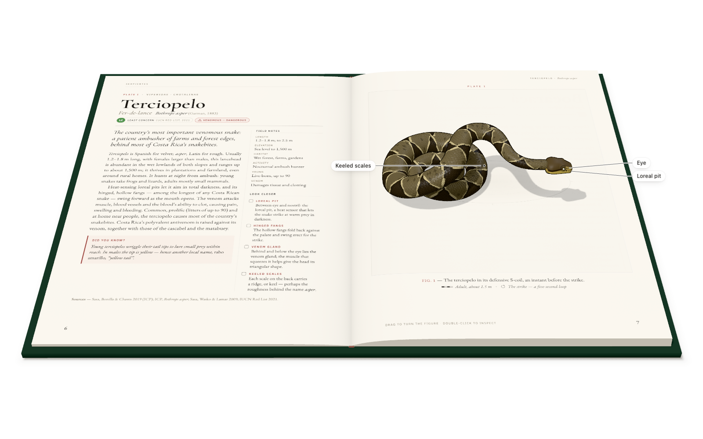
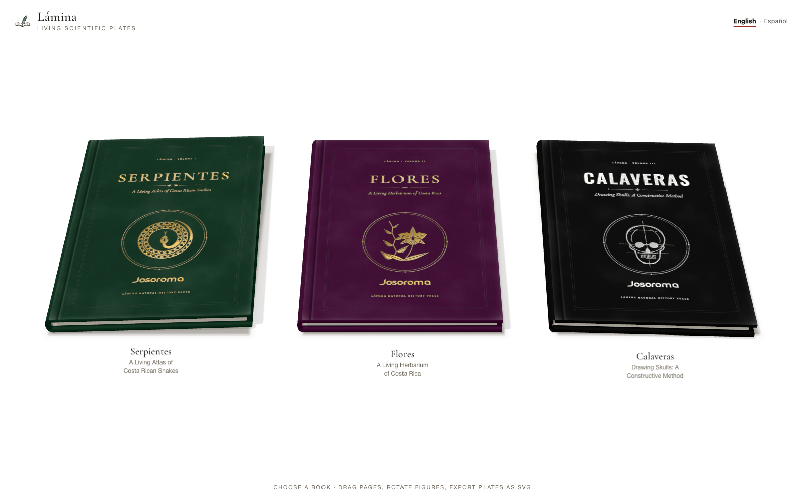
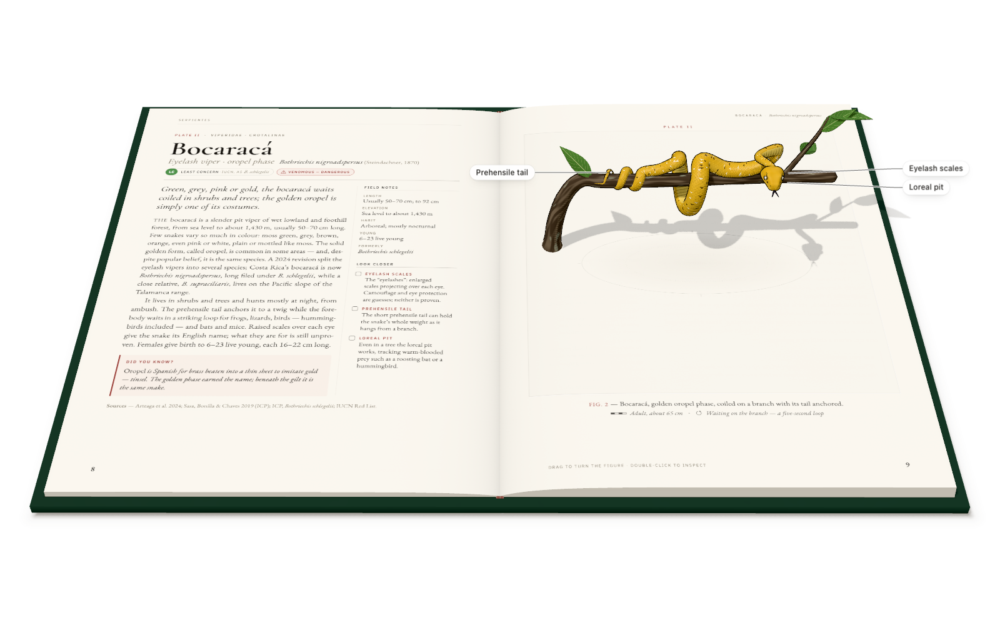
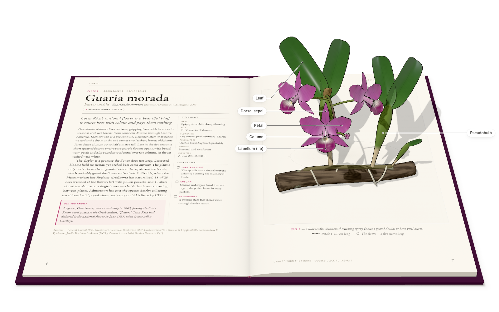
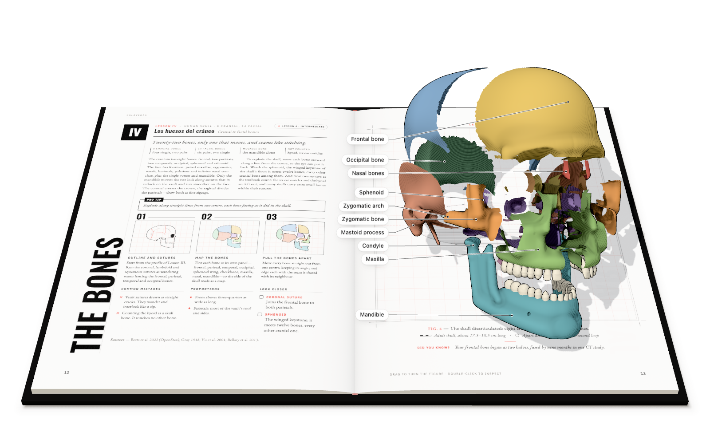
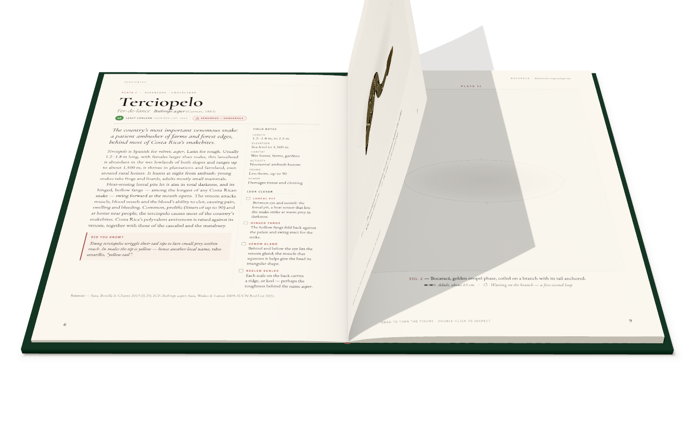
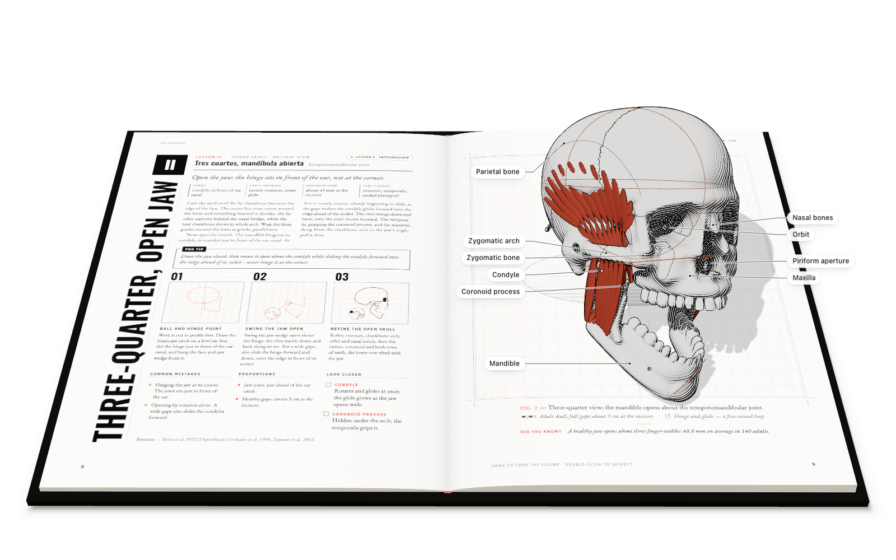
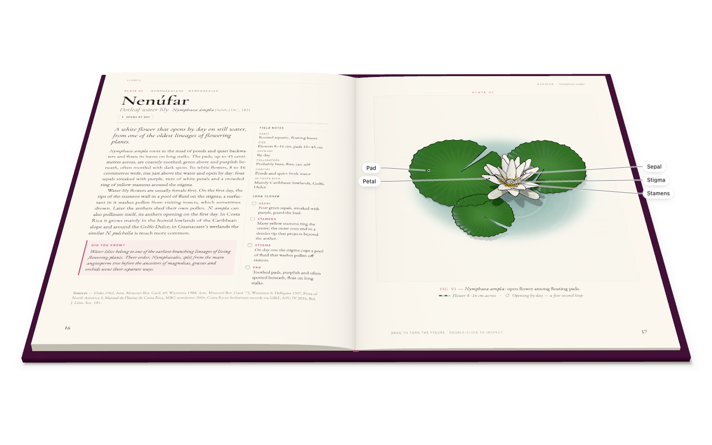
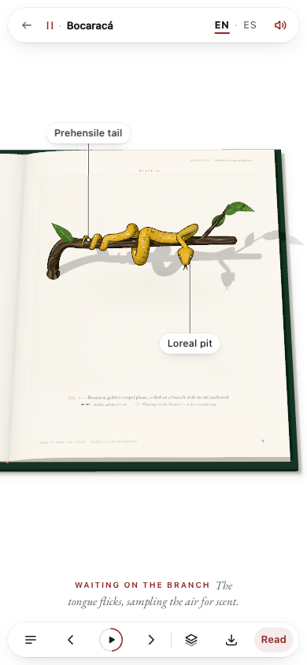
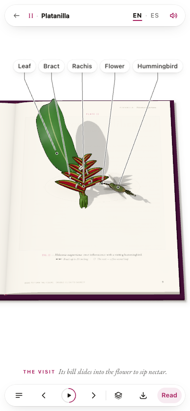

<p align="center">
  
</p>

<p align="center">
  <b>Turn any scientific topic into a living, page-turnable 3D book.</b><br>
  Real paper that curls. Pop-up figures that breathe. Five seconds of science on every plate.<br>
  Three books in English and Español, rendered with WebGPU and WebGL 2.
</p>

<p align="center">
  <a href="#demo">Demo</a> ·
  <a href="#quickstart">Quickstart</a> ·
  <a href="#the-claude-code-skill">The skill</a> ·
  <a href="#how-it-works">How it works</a> ·
  <a href="docs/">Docs</a>
</p>

<p align="center">
  
</p>

## Table of contents

- [The problem](#the-problem)
- [What Lámina is](#what-lámina-is)
- [Demo](#demo)
- [What a reader can do](#what-a-reader-can-do)
- [Quickstart](#quickstart)
- [The Claude Code skill](#the-claude-code-skill)
- [How it works](#how-it-works)
- [Under the hood](#under-the-hood)
- [Accuracy is a feature](#accuracy-is-a-feature)
- [Quality bar](#quality-bar)
- [Project layout](#project-layout)
- [Roadmap](#roadmap)
- [FAQ](#faq)
- [Credits](#credits)

## The problem

Natural-history plates are among the best teaching tools ever made: a whole
organism, drawn with care, labelled, set beside a page of exact prose. They
also stopped evolving. Digital textbooks became flat PDFs; 3D viewers dropped
the book, the typography and the sense of craft. Making something better takes
a studio of illustrators, 3D artists, developers, editors and fact-checkers.

## What Lámina is

**Lámina** (Spanish for *plate*) is two things:

1. **A book engine for the web.** A cloth-bound hardcover floats on a pure white
   page. Its leaves curl, cast shadows and land. On every right-hand page a 3D
   figure pops up as the page settles. You can turn it, dissect it, peel its
   layers, read its labels and export it as an SVG plate or a colouring page. It
   runs on WebGPU and falls back to WebGL 2.
2. **A Claude Code skill** ([`.claude/skills/lamina`](.claude/skills/lamina/SKILL.md))
   that takes a topic to a finished book. It plans the plates, builds parametric
   figures from reusable kits, writes the text, runs an adversarial fact-check,
   typesets every page and verifies the result in a browser on both GPU backends.

The three launch books below were made this way, by a team of agents
working against one set of contracts.

## Demo

<p align="center"></p>

| | book | what's inside |
|---|---|---|
|  | **Serpientes**<br>*A Living Atlas of Costa Rican Snakes*<br>[Book guide](docs/books/serpientes.md) | Seven species: the terciopelo's strike, the golden bocaracá on its branch, the coral's rings, the rattlesnake's buzz, the bushmaster on its eggs, the sea snake's paddle tail, the boa's coils. Skin, skeleton and venom layers. |
|  | **Flores**<br>*A Living Herbarium of Costa Rica*<br>[Book guide](docs/books/flores.md) | Six flowers: the national orchid opening, a hummingbird probing a heliconia, a passionflower's rippling corona, "hot lips" bracts parting, a golden trumpet falling, a water lily closing and reopening. Each can be dissected whorl by whorl. |
|  | **Calaveras**<br>*Drawing Skulls: A Constructive Method*<br>[Book guide](docs/books/calaveras.md) | Six drawing lessons in engraving style: a skull that builds itself from a sphere and a centre line, a jaw that rotates *and* glides, a profile turntable, the 22 bones exploded in colour, a jaguar's bite, and an eyelash pitviper threading an orbit. Each lesson has three construction panels drawn by code. |

<table>
<tr>
<td width="50%"><br><sub>Leaves bend out of the gutter, lift and fall, and pop-ups fold flat with them.</sub></td>
<td width="50%"><br><sub>Typeset lesson pages, with construction panels drawn from the same landmarks as the 3D model.</sub></td>
</tr>
<tr>
<td width="50%"><br><sub>Ink outlines and engraved hatching, calibrated to the light, in TSL.</sub></td>
<td width="50%"> <br><sub>On phones: one page at a time, the nearest labels, and a reading sheet for the text.</sub></td>
</tr>
</table>

Every figure exports as a vector colour plate, line art or PNG from the reader’s
Export control. Browse the [English captures](docs/outputs/en/) and
[Spanish captures](docs/outputs/es/). Example exports:
[passionflower colour plate](docs/outputs/en/flores/svg/granadilla-de-monte-color.svg) ·
[Spanish line art](docs/outputs/es/flores/svg/granadilla-de-monte-line.svg).

All three books have complete English and Español editions. Use the language
switch in the library or reader to change the text, figure labels, captions and
export annotations while keeping your place and figure settings. The choice is
remembered for routes without an explicit language.

Josoroma’s supplied wordmark is foil-stamped on the front and back covers: gold
on *Serpientes* and *Flores*, silver on *Calaveras*. A final “How this book was
made” leaf prints the original series prompt and that book’s brief; the Spanish
edition labels its translations. The [bilingual development notes](docs/prompts/06-bilingual.md)
record the request and provenance.

## What a reader can do

| | mouse / trackpad | touch | keyboard |
|---|---|---|---|
| turn pages | drag a corner (it follows, springs back, or commits on a flick), click a page | swipe, drag | ← → · PageUp/PageDown · Home/End |
| language | English / Español in the top bar | same | Tab to the language group, then arrow keys |
| contents | ☰ | ☰ | C |
| play / scrub the animation | ▶ and the *Moment* slider | same | Space |
| listen to the left page | headphones: listen, pause, resume; Stop in Help | headphones and Stop in the top bar | Tab to the control, then Enter |
| rotate a figure | drag it | drag it | [ ] |
| adjust the book's reading angle | drag up/down outside the book, or use **Book view** | Contents → **Book view** | ↑ ↓ · 0 restores the original view |
| inspect up close | double-click it, then orbit | double-tap | I, then ← → ↑ ↓ · Esc |
| zoom & pan | wheel, then drag on paper to pan (Shift-drag on the background) | pinch, then drag | + − 0 |
| layers · explode · labels | Layers popover | same | 1–9 · E · L |
| export | SVG colour plate, SVG line art, PNG | same | S |
| "look closer" | tap a note on the left page: its label lights up (and its layer turns on) | same | — |

All three books open at their original inclined angle. **Book view** offers a
continuous slider plus **Inclined view** and **Front view** presets. Dragging
upward on the white space brings the pages face-on; dragging downward restores
the incline. The angle stays put while reading and switching languages. Mouse
movement without a press does not move the camera. The frontal view reserves
space above the book for the top controls.

With reduced motion, turns are instant cuts and loops start paused. Every control
is reachable by keyboard, and every printed page (plates, introduction,
afterword, glossary, imprint and prompt pages) is mirrored as HTML for screen readers and the
reading sheet on phones and portrait tablets.

Caption playback is paced for reading: every sentence stays visible for at
least four seconds, with more time for longer text. The figure slows with its
caption so the explanation still matches the action.

The headphones read **only the current left page**, in the selected language,
using local **Chatterbox Multilingual V3**. Changing pages or languages stops
the previous narration; listening never turns the page automatically. Page-turn
sound effects have a separate switch in Help. The first generation takes longer;
subsequent plays reuse cached audio.

## Quickstart

```bash
npm install
npm run dev            # http://127.0.0.1:5173/#/   (library)
```

For local narration on Apple Silicon, run `npm run narration:setup` once
([uv](https://docs.astral.sh/uv/) required). Vite starts the voice service on demand
when Listen is used, in both development and preview. To run it separately, use
`npm run narration:serve`. See [narration setup and model provenance](docs/narration.md).

Open the library in [English](http://localhost:5173/#/en/) or
[Español](http://localhost:5173/#/es/). A link without a language uses the saved
choice, then a supported browser language, then English.

| URL | Purpose |
|---|---|
| `/#/en/serpientes?plate=3&t=2.4` | English plate at a specific moment (`&explode=0.6&layers=skeleton:1&labels=0&ui=0&style=engraving`) |
| `/#/es/flores` | Spanish edition of Flores |
| `/?gl=webgl#/es/calaveras` | Spanish edition with WebGL 2 forced |
| `/lab.html?type=skull&params={"lesson":"jaguar"}&view=side&lang=es` | Figure workbench with Spanish labels |
| `/typeset.html?book=calaveras&lang=es&page=all` | Every Spanish page with overflow checks |

Run the content checks with the dev server running:

```bash
npm test                         # i18n runtime and Spanish hyphenation
npm run validate:all             # both editions, author mark and prompt sources
npm run validate:all -- --fit    # render every page; check fit and edition parity
npm run audit -- --lang es --i18n
npm run audit -- --webgl         # figure loops and layers on WebGL 2
```

Build and serve the production bundle:

```bash
npm run build
npm run preview                  # http://127.0.0.1:4173
```

In another terminal, capture both editions (requires Google Chrome):

```bash
LAMINA_URL=http://127.0.0.1:4173 npm run capture -- --lang both
```

Captures go to `docs/outputs/en/` and `docs/outputs/es/`, each with its own
`manifest.json` and colour/line SVG exports for every figure. Add `--no-svg`
for an image-only capture, `--book serpientes` for one book, or `--webgl` to
check the fallback renderer.

## The Claude Code skill

The skill lives in [`.claude/skills/lamina/`](.claude/skills/lamina/SKILL.md) and
loads whenever you ask Claude Code for an interactive scientific book, plate,
atlas, field guide or drawing course. Try:

```text
Add a fourth book: "Ranas", the frogs of Costa Rica — six plates, each with a
five-second animation. Make it as good as Serpientes.
```

The skill drives one pipeline:

1. **Plan** the plates: subject, figure parameters, layers, look-closer
   structures and a five-second story for each.
2. **Scaffold** with `new-book.mjs` and `new-subject.mjs`. Both produce working
   files immediately.
3. **Research and write** to strict text budgets, then **fact-check
   adversarially**: two independent checkers with different lenses try to refute
   every claim, and a reviser re-verifies each issue before applying it.
4. **Build figures** from the kits, in real-world centimetres, as pure
   functions of loop time.
5. **Typeset, validate, audit.**
6. **Verify** with screenshots on both GPU backends, at desktop and phone
   sizes. Agents read every image.
7. **Capture and document.**

`scripts/bootstrap.mjs <dir>` starts a new project from the engine. References
in the skill cover the architecture, manifest schema, figure kits, motion,
design, accuracy and verification. See
[`docs/prompts/`](docs/prompts/) for the exact prompts used to build this repository.

## How it works

```
 topic ──► plan ──► manifest (text, sources) ──► fact-check ×2 ──► revise ─┐
                └─► figure subject (kits, cm, update(t)) ──► lab checks ───┤
                                                                            ▼
   typeset pages (Canvas 2D) ──► page textures ──► Book (WebGPU) ◄── FigureHost (pop-ups)
                                                     │
                     UI · input · audio · labels ◄───┴───► SVG / PNG export
```

- **Book engine.** Each leaf is evaluated on the CPU from an arc-length curl
  model with analytic normals, so paper never stretches, shadows are real and
  picking is exact. Only the top leaf of each stack and the leaves in flight are
  drawn; the rest is a striated block. Cloth boards have foil, a joint groove and
  endpaper turn-ins.
- **Typesetter.** Every page is set in Canvas 2D with Knuth–Plass line breaking,
  hyphenation, widow and orphan control, auto-fit and vector ornaments: plate
  marks, status chips, emblems and endpapers.
- **Figures.** Subjects are parametric generators built on kits:
  - `tube`: snakes, using parallel-transport spines and swept D-shaped sections.
  - `petal`: petals, corollas, leaves, a hummingbird and a pond.
  - `sdf`: bones, meshed with surface nets in a pool of module workers, split
    into one submesh per bone.
- **Ink.** TSL node materials draw inverted-hull outlines with a hand-inked
  wobble, plus hatching whose density is chosen per pixel so it never moirés. The
  thresholds calibrate themselves to the light rig. One uniform blends
  lithograph colour into black-ink engraving.
- **Export.** An ID buffer of part × tone band × depth is traced by marching
  squares, then RDP and Catmull-Rom Béziers. The output is a layered SVG with
  fills, hatching, numbered labels and a key.

## Under the hood

| | |
|---|---|
| Rendering | Three.js r186 `WebGPURenderer`, TSL node materials (WGSL on WebGPU, GLSL on WebGL 2), custom hue-preserving tone curve, transparent canvas over a CSS-white page (the clear colour is never tone-mapped) |
| Book | arc-length page curl, 3072² fitted shadow map, analytic contact shadows, procedural WebAudio page sounds |
| Figures | parametric subjects in real centimetres; CPU-swept tubes, lofted petal shells, SDF surface nets in Web Workers; pure `update(t)` for seamless 5-second loops |
| Type | Cormorant Garamond, EB Garamond, IBM Plex Sans Condensed, IBM Plex Mono, Oswald (self-hosted via @fontsource) |
| App | plain ES modules, no framework, Vite; three bilingual book manifests |
| Verification | headless Chrome on WebGPU and WebGL (playwright-core): screenshots, seam audit, SVG capture |

## Accuracy is a feature

A beautiful plate with a wrong fact is a failure. The three books carry **207
sourced claims**. Six fact-checkers raised **91 issues** across them. Some
examples:

- the 2024 split of the eyelash pitvipers;
- a jaw that was taught to hinge before it glides;
- a corolla size taken from a non-Costa Rican flora;
- captions that did not match their animation.

Every issue was re-verified against primary sources and then applied or
rejected, and each verdict is logged in the research dossiers
([serpientes](docs/books/serpientes-research.md) ·
[flores](docs/books/flores-research.md) ·
[calaveras](docs/books/calaveras-research.md)). Safety text, such as snakebite
first aid, follows the Instituto Clodomiro Picado and WHO guidance. All text,
figures and construction drawings are original.

## Quality bar

- Pure white stage (#ffffff, verified by pixel sampling). The open book fills
  about 95 % of a landscape screen; a phone shows one page.
- Every figure checked on WebGPU **and** WebGL 2, at desktop and phone sizes.
- Seamless loops: the pose at *t* = 0 equals the pose at *t* = 5 by construction,
  checked by `npm run audit`.
- No per-frame allocation in figure updates. Heavy meshing runs in workers.
  Subject code loads lazily per book.
- Keyboard-complete, reduced-motion aware, with HTML mirrors of every plate.

## Project layout

```
index.html                 the reader (library ↔ books)       lab.html       figure workbench
src/app/                   boot, Reader, Library, page cache  typeset.html   page preview
src/engine/                renderer, stage, book, figures,    book-test.html page-curl harness
                           typeset, ui, input, audio, export  ui.html        UI harness
src/kits/                  ink, patterns, tube, petal, sdf
src/subjects/              snakes, flowers, skulls, demo
src/books/                 English manifests, es/ editions, making/ prompt texts
src/i18n/                  language runtime, edition composition, Spanish dictionaries
scripts/                   shot, capture, audit, validate-books, export-svg
docs/                      architecture (contracts), books (per-book docs + research), prompts, outputs
.claude/skills/lamina/     the skill: SKILL.md, references, templates, scripts, evals
```

## Roadmap

- More books: frogs, butterflies, hummingbirds, volcanoes, the human hand.
- A `wing` kit (butterflies, birds) and a `shell` kit (molluscs, fossils).
- WebXR "hold the plate": the figure standing on a real table (feature-detected).
- Persistent mesh cache (IndexedDB) for instant revisits; optional WASM meshing.
- Print-ready PDF export of a whole book.

## FAQ

**Does it need WebGPU?** No. It uses WebGPU where available and falls back to
WebGL 2 automatically; `?gl=webgl` forces the fallback.

**Which languages are available?** English and Español for all three books,
including navigation, labels, the reading sheet and export annotations. Scientific
names and source titles retain their original form.

**Can I add my own book without writing 3D code?** If an existing subject
covers your topic (snakes, flowers, skulls), a book is just a manifest. New kinds
of organism need a subject module. The skill scaffolds one and the kits do the
heavy lifting.

**Are the facts reliable?** Every claim has a source in the research dossier
and survived two independent adversarial checks. This is still a prototype, not
a medical or field reference: in a snakebite, go to a hospital.

**Is any of the content copied?** No. Text, figures and construction steps were
written and drawn for these books. Reference books inspired the form only.

**Is the imprint real?** No. *Lámina Natural History Press* is fictional.

## Credits

Originally built with Claude Code (Claude Opus) as a team of agents directed by
Josoroma; the interrupted bilingual finishing work was continued with Codex. The
[archived prompts](docs/prompts/) retain the original authorship and workflow history.
Inspired by [april-zhu.com/colorfigures](https://april-zhu.com/colorfigures),
[wheresryan22/anatomy](https://github.com/wheresryan22/anatomy) and
[jakub.kr/skills](https://jakub.kr/skills). Three.js (MIT) and the Cormorant
Garamond, EB Garamond, IBM Plex and Oswald typefaces (SIL Open Font License).

No license has been chosen yet; all rights are reserved until a `LICENSE` file is added.
