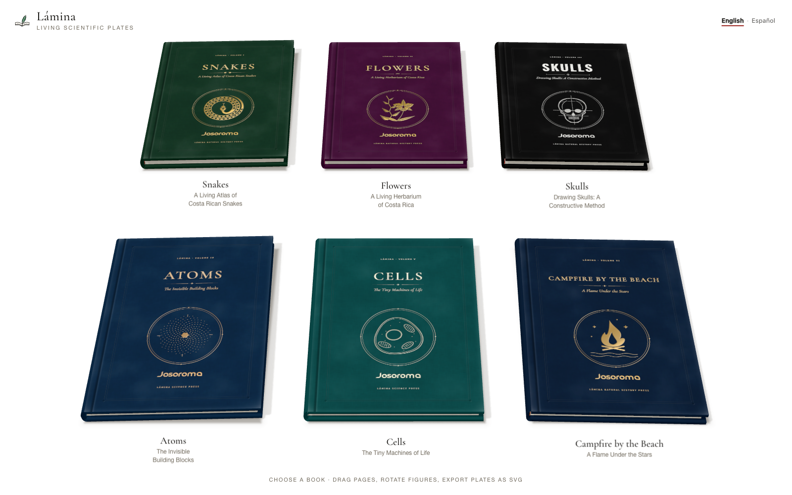

<p align="center"></p>

# Lamina

A book engine, an authoring skill, and independent series of interactive scientific books. Each series is a complete application that can live in its own repository.

**[Read Series 01 — Lamina](https://josoroma.github.io/Lamina/)** · **[Authoring skill](.claude/skills/lamina/SKILL.md)** · **[Book guides](series/lamina/docs/README.md)**

## Series 01 — Lamina

Six books in **English and Español**, with language switching, page turns, inspectable 3D figures, layers, labels, and SVG/PNG export.

| English | Español | Read |
|---|---|---|
| Snakes | Serpientes | [English](https://josoroma.github.io/Lamina/#/en/serpientes) · [Español](https://josoroma.github.io/Lamina/#/es/serpientes) |
| Flowers | Flores | [English](https://josoroma.github.io/Lamina/#/en/flores) · [Español](https://josoroma.github.io/Lamina/#/es/flores) |
| Skulls | Calaveras | [English](https://josoroma.github.io/Lamina/#/en/calaveras) · [Español](https://josoroma.github.io/Lamina/#/es/calaveras) |
| Atoms | Átomos | [English](https://josoroma.github.io/Lamina/#/en/atomos) · [Español](https://josoroma.github.io/Lamina/#/es/atomos) |
| Cells | Células | [English](https://josoroma.github.io/Lamina/#/en/celulas) · [Español](https://josoroma.github.io/Lamina/#/es/celulas) |
| Campfire by the Beach | Fogata en la playa | [English](https://josoroma.github.io/Lamina/#/en/fogata) · [Español](https://josoroma.github.io/Lamina/#/es/fogata) |

<p align="center"></p>

## Repository layout

```text
.claude/skills/lamina/       Reusable authoring skill, templates and generators
series.json                 Catalog of series
series/
  lamina/                   Series 01: self-contained application
    series.json             Name, languages, books and publication URL
    src/app/                Library, reader and narration controls
    src/engine/             Reusable book, rendering and export engine
    src/kits/               Reusable geometry and illustration tools
    src/books/              Six English books, Spanish editions, prompts
    src/subjects/           Their interactive 3D figures
    public/                 Author mark, character assets and license notices
    scripts/                Validation, captures and narration tools
    docs/                   Research, prompts, book guides and outputs
    package.json            Dependencies and commands for this series
.github/workflows/pages.yml Build and publish Series 01 to GitHub Pages
```

The engine is bundled with the reference series so that this folder remains runnable on its own. The skill's bootstrap command copies the reusable engine into a new project and creates a bilingual starter book; it can also copy the complete selected series. No existing book content needs to be edited to start another series.

## Run locally

Use Node.js 24 or a supported Vite-compatible Node.js release.

```bash
npm ci
npm run dev
```

Open `http://localhost:5173/`. Root commands delegate to the `series/lamina` workspace:

```bash
npm test
npm run validate:all
npm run build
npm run preview
```

You can also work directly inside `series/lamina/` with its own `package.json` and lockfile. The full [application guide](series/lamina/README.md) describes the reader, figures and verification tools.

## Create another series in another repository

From this repository:

```bash
npm run new:series -- ../MyNextSeries --author "Your name"
cd ../MyNextSeries
npm install
npm run dev
```

This creates a standalone application with the engine, skill and a bilingual starter. Add as many books as the new series needs; six is the first collection's size, not a limit. Use `--with-books` to start with a complete copy of the selected series instead. The generator does not initialize Git, select a remote or publish anything.

See the [series workflow](.claude/skills/lamina/references/series.md) for selecting a source series and adding books and figure subjects.

## Publication

Pushes to `main` run the tests, validate both editions, build the first series and deploy **only its built site** to [GitHub Pages](https://josoroma.github.io/Lamina/). The repository retains the source, skill, research and outputs. Hash-based book URLs work under the `/Lamina/` project path.

Narration uses **Chatterbox Multilingual V3** and reads only the current left page. All **134 narratable left pages** across the twelve editions have prepared recordings: **1,567 MP3 clips**, shared where the exact text repeats. Page and language changes stop playback. GitHub Pages serves these recordings directly; local development can also run the Python synthesis service. The deployment checks every page against its current text before publishing. The [narration documentation](series/lamina/docs/narration.md) describes generation, verification and updating the recordings after editing a book.

## Assets and attribution

Josoroma's supplied mark appears on the covers. Third-party character provenance and CC0 terms are in [public/assets/characters](series/lamina/public/assets/characters/README.md); Three.js and font license notices are in [public/licenses](series/lamina/public/licenses/README.md). Book prompts, research references and development records are preserved in each series' documentation.
